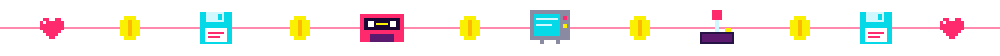
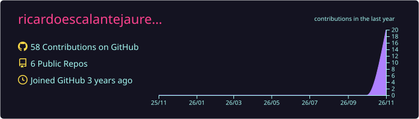
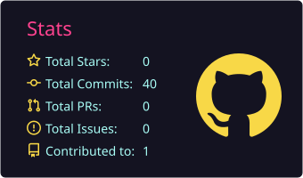
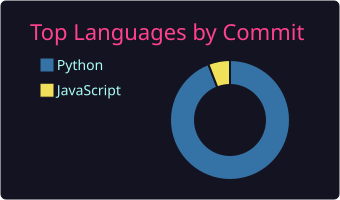

<p align="center">
  
</p>

<p align="center">
  <a href="https://github.com/ricardoescalantejauregui">
    
  </a>
</p>

<p align="center">
  
  
  
  
</p>



## 🕹️ PLAYER SELECT

```text
RETRO-BIOS v1.985                         (C) MEXICO
-----------------------------------------------------
MEMORY TEST ................ 640K OK
FLOPPY DRIVE A: ............ READY
LOADING PLAYER_1 ........... ██████████ 100%

CLASS ...................... FULL STACK ENGINEER
REGION ..................... MEXICO
SPECIAL MOVES .............. WEB APPS · APIs · DATA · CLOUD
BONUS ABILITY .............. LLM AGENTS · RAG

TIME CIRCUITS .............. ON   (TARGET SPEED: 88 MPH)
NEON GRID .................. ONLINE
REPLICANTS ................. 0 DETECTED
HOVERBOARD ................. BACKORDERED

> PRESS START_
```


## ⚔️ INVENTORY

**🎮 Languages**
<p>
  
</p>

**🧩 Frameworks & runtimes**
<p>
  
</p>

**💾 Data**
<p>
  
</p>

**🛰️ Cloud & DevOps**
<p>
  
</p>

**⚡ Power-ups (AI)**
<p>
  
  
  
  
  
  
</p>


## 🏆 LEVELS COMPLETED

<table>
  <tr>
    <td width="50%" valign="top">
      <h3>🌐 WORLD 1-1</h3>
      <h4><a href="https://github.com/ricardoescalantejauregui/LaCaffettiera">☕ LaCaffettiera</a></h4>
      Company website for a coffee shop: blog, services, contact and social sections with an admin panel.
      <br/><br/>
      
      
      <br/>
    </td>
    <td width="50%" valign="top">
      <h3>🏰 WORLD 1-2</h3>
      <h4><a href="https://github.com/ricardoescalantejauregui/AcademyMagic">🧙 GrimoireRegistry</a></h4>
      REST API to manage student applications and grimoire assignments for a magic academy — auth, migrations, Swagger docs and tests.
      <br/><br/>
      
      
      
      <br/>
    </td>
  </tr>
  <tr>
    <td width="50%" valign="top">
      <h3>🚀 WORLD 2-1</h3>
      <h4><a href="https://github.com/ricardoescalantejauregui/aura-doc-pipeline">📄 aura-doc-pipeline</a></h4>
      Document analysis pipeline: ingests PDF/DOCX, builds semantic embeddings and serves search through a production-style API with metrics.
      <br/><br/>
      
      
      
      <br/>
    </td>
    <td width="50%" valign="top">
      <h3>👾 BONUS STAGE</h3>
      <h4><a href="https://github.com/ricardoescalantejauregui/agentes">🤖 agentes</a></h4>
      Experiments with LLM agents and tool calling.
      <br/><br/>
      
      
      <br/>
    </td>
  </tr>
</table>


## 📼 HIGH SCORES

<p align="center">
  
</p>
<p align="center">
  
  
</p>

<p align="center">
  <picture>
    <source media="(prefers-color-scheme: dark)" srcset="https://raw.githubusercontent.com/ricardoescalantejauregui/ricardoescalantejauregui/output/snake-dark.svg" />
    <source media="(prefers-color-scheme: light)" srcset="https://raw.githubusercontent.com/ricardoescalantejauregui/ricardoescalantejauregui/output/snake.svg" />
    
  </picture>
</p>


<p align="center">
  
</p>
